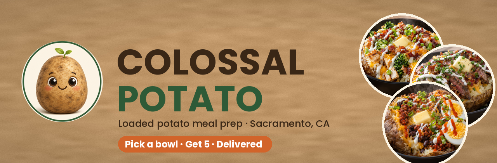
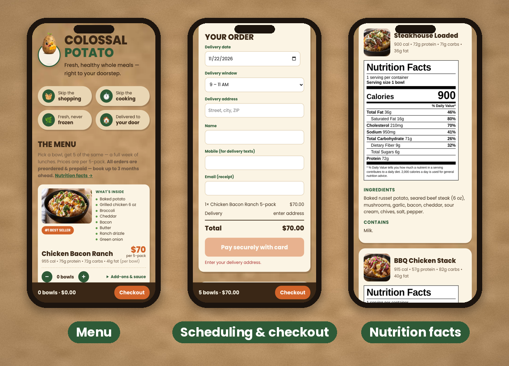
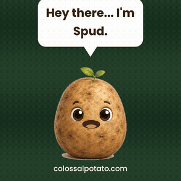
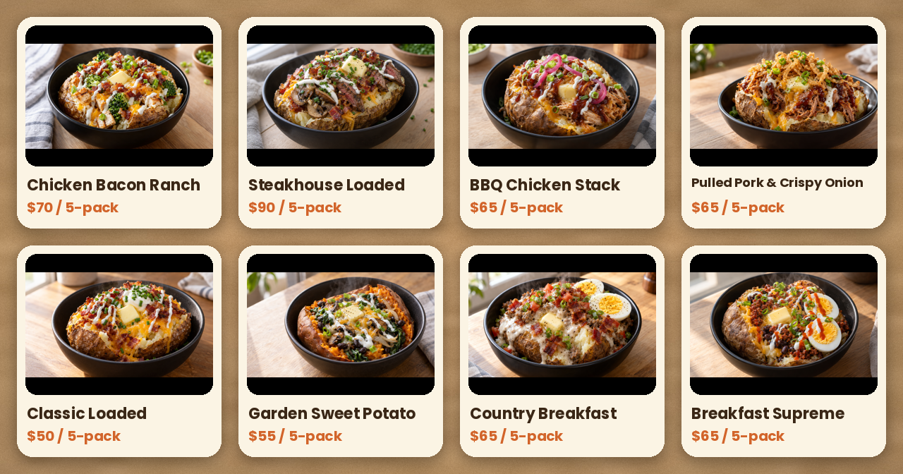
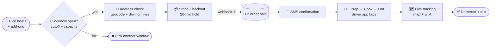
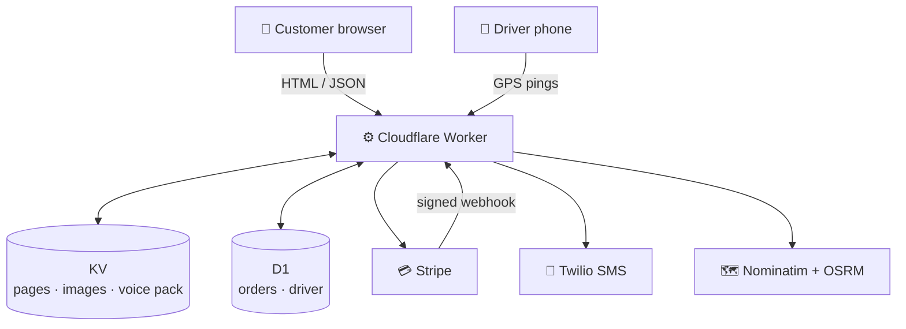

<div align="center">

<a href="https://colossalpotato.com"></a>

<br>

[](https://colossalpotato.com)
[](https://colossalpotato.com/nutrition)


### Pick a bowl. Get 5. Delivered.
A complete serverless ordering platform for a Sacramento meal-prep brand.<br>
It handles scheduling, delivery pricing, payments, texts, live tracking, and a talking mascot that sells.

</div>

---

## 👀 Take a look

<div align="center">

</div>

<table>
<tr>
<td width="34%" align="center" valign="top">
<br>
<sub><b>Meet Spud</b>: lip-synced, voiced, and in charge of upsells</sub>
</td>
<td width="66%" valign="top">

### 🥔 The mascot that sells
- **25+ moves and moods**: jump, dance, wink, sneeze, sleepy, shy, hiccup…
- **Real voice + lip-sync**: ElevenLabs clips decoded in the browser, with the mouth driven live by a Web Audio `AnalyserNode`
- **Knows what you picked**: adding the Steakhouse bowl gets *"Now you're eating like a boss,"* then a matching upsell like *"Add extra steak? Protein bomb"*
- **Smart suggestions**: offers a breakfast pack when the cart has none, a second pack "for the freezer," or a family pack. Suggestions are throttled so it never nags.
- **Lives in the logo**: looks toward your cursor, giggles when rubbed, gets sleepy after 40 s idle, and cheers when you check out
- **Lightweight**: the page is 46 KB, and the voice pack lazy-loads after the first tap

</td>
</tr>
</table>

---

## 🍽️ The menu

<div align="center">

</div>

<details>
<summary><b>📊 Macros per bowl</b> (tap to expand)</summary>
<br>

| Bowl | Calories | Protein | Carbs | Fat |
|---|--:|--:|--:|--:|
| 🥓 Chicken Bacon Ranch | 955 | **75 g** | 72 g | 41 g |
| 🥩 Steakhouse Loaded | 900 | **72 g** | 71 g | 36 g |
| 🍗 BBQ Chicken Stack | 915 | 57 g | 82 g | 40 g |
| 🐖 Pulled Pork & Crispy Onion | 1,075 | 59 g | 83 g | 57 g |
| 🧀 Classic Loaded | 630 | 21 g | 66 g | 32 g |
| 🍠 Garden Sweet Potato | 685 | 24 g | 93 g | 26 g |
| 🍳 Country Breakfast | 1,090 | 47 g | 77 g | 66 g |
| 🌶️ Breakfast Supreme | 1,140 | 54 g | 89 g | 64 g |

Calculated from USDA FoodData Central using standard portions. Full FDA-style labels, ingredients, and allergens are at **[/nutrition](https://colossalpotato.com/nutrition)**.
</details>

---

## 🧭 How an order flows



<details>
<summary><b>⏰ Delivery windows & pricing rules</b></summary>
<br>

| Order by | Delivered | Notes |
|---|---|---|
| 7 PM the night before | **9 – 11 AM** | next-morning |
| 11 AM | **2 – 4 PM** | same day |
| 3 PM | **7 – 9 PM** | same day |

- Preorders are open up to **3 months** ahead.
- Capacity caps are enforced per day (`DAILY_CAP`) and per window (`WINDOW_CAP`). Unpaid holds expire after 20 minutes.
- Delivery fee is based on driving distance: **$7 up to 10 mi**, **$14 up to 20 mi**, one fee per order. Addresses beyond 20 mi are declined.
</details>

<details>
<summary><b>🚚 Driver app & live tracking</b></summary>
<br>

- A nearest-neighbor pass orders each window's stops, starting from the kitchen.
- One tap sets **Prepping → Cooking → Out for delivery** for the whole window and texts every customer.
- The phone sends GPS pings while driving. Customers see the car and an ETA (OSRM route plus 4 min per stop ahead of them), cached for 60 s.
- **Privacy:** the map shows no car while it's within 0.4 mi of the kitchen, so the home address is never exposed.
</details>

<details>
<summary><b>🔎 Local SEO</b></summary>
<br>

- `FoodEstablishment` + `FAQPage` JSON-LD with service-area cities (Sacramento, West Sac, Natomas, Elk Grove, Rancho Cordova…)
- Keyword-targeted title and meta, Open Graph cards, a canonical URL, descriptive image alt text
- `robots.txt` (keeps the driver, tracking, and API pages out of search) and `sitemap.xml`, both served by the Worker
</details>

---

## 🏗️ Architecture



## 🎬 Content pipeline

Everything the brand posts is generated from code in this repo:

| Output | How |
|---|---|
| 🧾 Print + Instagram menus | `menu/` with ReportLab, kraft-paper design, auto-pulled macros |
| 🎥 Promo videos | `video/`: PIL frame compositing at 1080×1920/30 fps, an RMS audio envelope driving Spud's mouth, and an FFmpeg encode |
| 📐 Ad sizes | `video/sizes.sh` exports every video as **4:5, 1:1, and 16:9** for Facebook, Instagram, and YouTube |
| 🎙️ Voices | ElevenLabs takes, split into clips by silence detection and loudness-normalized for phone speakers |

## 📁 Repo layout

```
site/    Worker + pages (menu, thanks, tracking, driver, nutrition) + Spud mascot module
menu/    PDF and Instagram menu generators
video/   Promo renderer, lip-sync, ad-size exporter
docs/    README visuals
```

## 🔐 Security notes
- Every credential (Stripe, Twilio, driver code, upload key, kitchen coordinates) is a **Cloudflare secret**, and none is in this repo.
- Prices are computed on the server. The client cart is never trusted.
- Stripe webhooks are verified with HMAC-SHA256 and a 10-minute timestamp window.

<div align="center">
<br>
<br>
<sub>© 2026 Colossal Potato · BnX Kitchens LLC · Sacramento, CA</sub>
</div>
